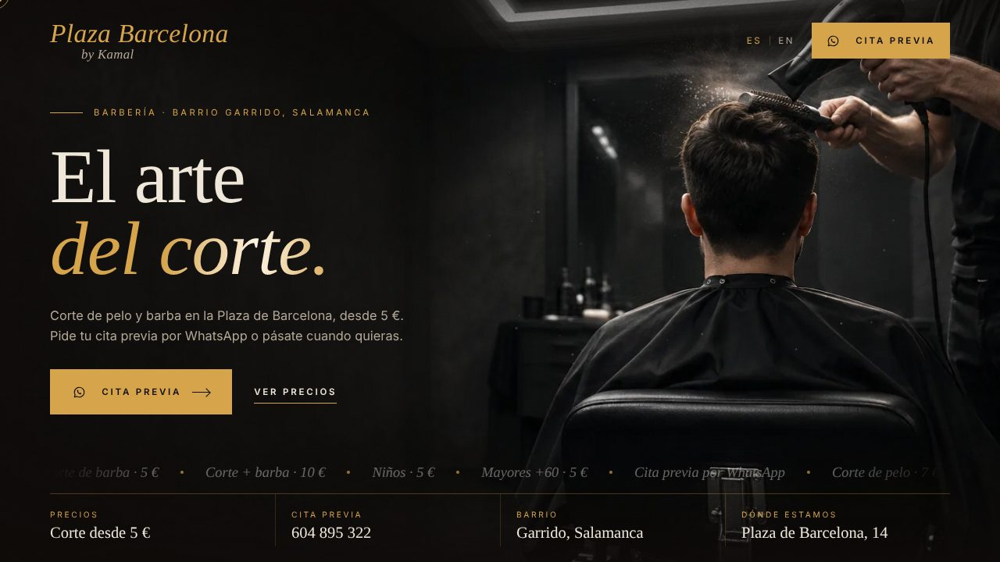

<h1 align="center">Hi, I'm Ziad El Alami 👋</h1>

  <strong>Full-Stack Developer</strong> · I build websites, online shops and AI tools that bring small businesses more customers. 
  Based in Spain · Remote, worldwide · English · Français · Español

  
  
  

---

**EN** I help small businesses get more customers online: websites, online shops, QR menus, booking systems and AI assistants. 100% remote, clear prices, fast delivery.

**FR** J'aide les petits commerces à trouver plus de clients en ligne : sites web, boutiques, menus QR, réservations et assistants IA. Tout à distance, prix clairs, livraison rapide.

**ES** Ayudo a pequeños negocios a conseguir más clientes en internet: páginas web, tiendas online, menús QR, reservas y asistentes con IA. 100 % a distancia, precios claros, entrega rápida.

---

## 💼 Client work

**[Barbería Plaza Barcelona](https://barberiaplazabarcelona.es/)**, a barbershop in Salamanca, Spain. Website on its own domain, in Spanish and English: video hero, price list, appointments through WhatsApp in one tap, map and directions. Fast, mobile-first, hosted for free on GitHub Pages.
HTML · CSS · JavaScript · GitHub Pages · custom domain · [Live site](https://barberiaplazabarcelona.es/) · [Code](https://github.com/ziad-web-studio/barberia-plaza-barcelona)

## ⭐ Featured project: Momentum

**Momentum** is an installable habit and task tracker (PWA, works offline) with features you won't find in typical habit apps: your **year in 3D** built from your real data (shareable as an image), a **Sunday review** written like a coach with one-click fixes, and a **"never twice"** comeback mode. Streaks that respect skipped days, pauses and vacations; five frequencies; reminders; weekly insights; light/dark theme; French, Spanish and English.

- **Front end:** vanilla JavaScript, Three.js with hand-written shaders, no framework, no build step. · [Landing page](https://elalamiz605-tech.github.io/suivi-habitudes/) · [Open the app](https://elalamiz605-tech.github.io/suivi-habitudes/app.html) · [Code](https://github.com/elalamiz605-tech/suivi-habitudes)
- **Back end, [Momentum Cloud](https://github.com/elalamiz605-tech/momentum-cloud):** accounts, cross-device sync with conflict detection, Web Push reminders (iOS included), server-side AI coach (Claude API) and "buddies" that share their day. Node.js, Express 5, PostgreSQL, Docker, automated tests.

## 🛠️ What I can do for you

| Service | What you get |
| --- | --- |
| **Websites** | Responsive business websites and landing pages: fast, SEO-friendly, on your own domain. |
| **Online shops** | Product pages, cart and checkout ready to connect to Stripe or PayPal. |
| **Booking systems** | Online appointments for salons and services, with an admin dashboard. |
| **QR menus** | Digital menus for cafés and restaurants, in several languages, easy to update. |
| **AI chatbots** | Assistants powered by Gemini, OpenAI or Claude that answer your customers 24/7, using only your business's information. |
| **Security check** | A security audit of your website (HTTPS, headers, exposed files, email spoofing) with a clear report, then the fixes. |
| **Automation** | Python and JavaScript tools that remove repetitive work: quotes, invoices, reports, API integrations. |

**How we work together:** ① a short call or email about your business → ② a clear proposal with a fixed price → ③ I build it and share previews as I go → ④ launch on your domain, then help when you need changes.

## 🧩 More projects

**For small businesses**

| Project | What it is | Links |
| --- | --- | --- |
| **Salon booking** | Online booking for barbershops and hair salons: 3D homepage, one-minute booking on the phone, private links to manage or cancel, admin dashboard. Next.js · TypeScript · PostgreSQL · Drizzle · Playwright | [Demo](https://elalamiz605-tech.github.io/rizo-studio/) · [Code](https://github.com/elalamiz605-tech/salon-booking) |
| **QR menu for cafés** | Customers scan the QR code on the table and read the menu in Spanish, English or French. Simple admin page for dishes and prices. HTML · CSS · JavaScript | [Demo](https://elalamiz605-tech.github.io/menu-qr-cafe/) · [Code](https://github.com/elalamiz605-tech/menu-qr-cafe) |
| **Quotes & invoices** | Professional quotes and invoices, payment tracking and client list, all in the browser. No account, no server. HTML · CSS · JavaScript | [App](https://elalamiz605-tech.github.io/generateur-devis-factures/) · [Code](https://github.com/elalamiz605-tech/generateur-devis-factures) |
| **AI business chatbot** | Customer-support assistant that answers only from the business's data, in the customer's language; API key kept server-side. Python · Flask · Gemini API | [Code](https://github.com/elalamiz605-tech/ai-business-chatbot) |
| **Restaurant website** | Showcase site for a restaurant: tabbed menu, live opening status, map and table-booking dialog. HTML · CSS · JavaScript | [Demo](https://elalamiz605-tech.github.io/restaurant-website-demo/) · [Code](https://github.com/elalamiz605-tech/restaurant-website-demo) |

**Online shops**

| Project | What it is | Links |
| --- | --- | --- |
| **RWAFA** | Storefront for a streetwear brand inspired by Rif Amazigh culture: product pages, cart and 3D hero. HTML · CSS · JavaScript · Three.js | [Demo](https://elalamiz605-tech.github.io/rwafa-store/) · [Code](https://github.com/elalamiz605-tech/rwafa-store) |
| **ONI** | Storefront for a premium anime-inspired hoodie brand, with cart and a 3D banner. HTML · CSS · JavaScript · Three.js | [Demo](https://elalamiz605-tech.github.io/oni-store/) · [Code](https://github.com/elalamiz605-tech/oni-store) |

**Agency & content sites**

| Project | What it is | Links |
| --- | --- | --- |
| **Automia** | Bilingual (ES/FR) website for an automation and AI agency in Spain. One HTML file, no build step. HTML · CSS | [Demo](https://elalamiz605-tech.github.io/automia/) · [Code](https://github.com/elalamiz605-tech/automia) |
| **Animated agency website** | Cinematic site for an AI agency: real-time 3D scene, animated interface and scroll effects. HTML · CSS · Three.js · GSAP | [Demo](https://elalamiz605-tech.github.io/automation-agency-demo/) · [Code](https://github.com/elalamiz605-tech/elalamiz605-tech.github.io/tree/main/automation-agency-demo) |
| **El Lab Productivo** | Spanish-language blog testing AI tools for freelancers and small businesses. Neon design, background film, light mobile mode, basic SEO. HTML · CSS · Video | [Site](https://elalamiz605-tech.github.io/el-lab-productivo/) · [Code](https://github.com/elalamiz605-tech/el-lab-productivo) |
| **Portfolio** | Bilingual (EN/FR) one-page portfolio: services, projects and contact. HTML · CSS · JavaScript | [Site](https://elalamiz605-tech.github.io) · [Code](https://github.com/elalamiz605-tech/elalamiz605-tech.github.io) |

**Developer tools & security**

| Project | What it is | Links |
| --- | --- | --- |
| **Website security scanner** | Checks a website in a few seconds: HTTPS and certificate, security headers, cookies, exposed files (`.git`, `.env`, backups), mixed content and email spoofing (SPF/DMARC). Grade A to F and a report in English, French or Spanish, as a web app or a CLI (`--fail-under` blocks a deployment in CI). Passive checks, SSRF-protected, zero dependencies, 155 tests. TypeScript · Node.js · Vitest · GitHub Actions · Render | [Try it](https://website-security-scanner-jbs9.onrender.com) · [Code](https://github.com/elalamiz605-tech/website-security-scanner) |
| **mes-themes** | Plugin for Claude Code: eleven animated themes (neon, hologram, hyperspace…) for the desktop and mobile apps, switched with one command. TypeScript · Claude Code plugin | [Code](https://github.com/elalamiz605-tech/mes-themes-) |

## 🧰 Tech stack

**Languages**

**Frameworks & runtime**

**Data, testing & deployment**

**AI**

## 📬 Contact

Have a project in mind? I'd be happy to talk about it, wherever you are.
Un projet ? Parlons-en. · ¿Tienes un proyecto? Hablemos.

**[elalamiz605@gmail.com](mailto:elalamiz605@gmail.com)** · [Portfolio](https://elalamiz605-tech.github.io) · [Blog: El Lab Productivo](https://elalamiz605-tech.github.io/el-lab-productivo/)
